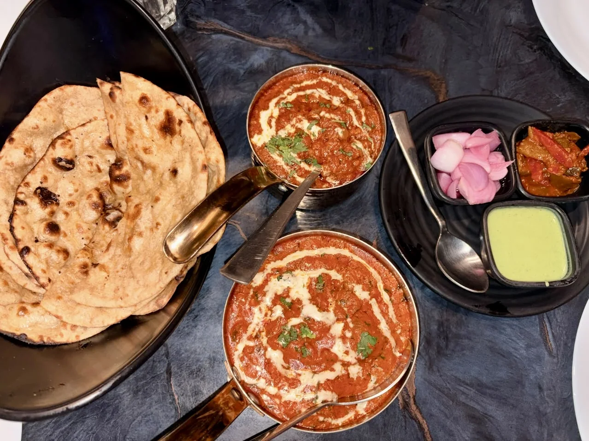

<div align="center">


# Swaadfolio
### A little more joy, a little more aaram in the kitchen. 🍲

**An Indian recipe book for curious cooks, first-timers and family favourites.**

[Explore the recipe book](https://swaadfolio.leafyhutch64.chatgpt.site) · [See the dishes](#on-the-menu) · [Run it locally](#get-started) · [Contribute](CONTRIBUTING.md)

<sub>Created by Aryan Singh Studio · The website is public—open it and start cooking.</sub>

</div>

---



## Garam khana, khush dil ❤️

Picture the sizzle of jeera in a warm pan, the smell of fresh dhaniya, and a meal you made yourself. Whether you're making your first chilla or returning to a family favourite, Swaadfolio is here to help you feel at home in the kitchen.

Our collection brings together **14 home-style Indian recipes**—from a quick breakfast to a comforting plate to share.

### 🔎 Aaj kya banayein?

Search by dish, region, ingredient or Hinglish name. Looking for **pyaaz**, **tamatar** or something for breakfast? Start with what you know and find a recipe that feels right.

### 🌿 Pehchaano apni ingredients

See familiar Hinglish names alongside English, so *onion* feels like **pyaaz** and *turmeric* feels like **haldi**. Selected ingredients include photographs to help you recognise them.

### 👩‍🍳 Chalo, step by step

Switch on **Beginner cooking mode** and take one instruction at a time. Check off ingredients as you prepare them, take your time, and enjoy the little moments along the way.

### 🌍 Apni bhasha mein

Choose **Hinglish** for the methods and kitchen notes in all 14 curated recipes, including Beginner cooking mode. English is also available. Spanish and French are **starter interface packs** for navigation and cooking controls; their recipe text and forms remain in English. Ingredient quantities and some screens remain English in Hinglish mode too. Your language preference stays in this browser. See [language coverage](docs/languages.md).

### 📖 Apni recipes, apni kahani

Save favourites for another day or add your own Indian recipes with a photo—perhaps a dish that reminds you of home. You can edit or delete your personal recipes whenever you like.

### 🍽️ Chhoti ya badi bhookh?

For **Besan Chilla**, choose 1–6 servings to adjust ingredient amounts and the water in the method. These are estimates: taste and adjust the seasoning, and remember that cooking time and pan size may change. Smart portions are available for this recipe only for now.

> **A note about your cookbook:** Personal recipes, photos and bookmarks stay in the current browser on this device. They don't sync between devices, and clearing site data can remove them.

## On the menu

| Region | A taste of Swaadfolio |
| --- | --- |
| Karnataka | Rava Dosa |
| Maharashtra | Kanda Poha |
| Gujarat | Khaman Dhokla |
| Uttar Pradesh | Lucknowi Matar Pulao |
| West Bengal | Aloo Posto |
| Tamil Nadu | Tomato Rasam |
| Kerala | Paal Payasam |
| Punjab | Paneer Butter Masala · Chana Masala |
| North India | Dal Tadka · Aloo Gobi · Besan Chilla · Jeera Aloo |
| Indian home-style | Tomato Chutney |

These recipes are home-style versions. Ingredient photo coverage and portion scaling are still being expanded. Recipes and photographs are not a claim of professional kitchen testing.

## Get started

Open the public recipe book using the link above. To run your own copy locally:

```bash
git clone https://github.com/dapperdude404/swaadfolio.git
cd swaadfolio
python3 -m http.server 8000 --directory dist
```

On Windows, use `py -m http.server 8000 --directory dist`. Open [localhost:8000](http://localhost:8000). No package installation or build step is required.

## Made for sharing ideas

Swaadfolio begins with Indian regional cooking. Future ideas include more recipes, wider smart-portion coverage and an Android app; these are plans, not released features.

Want to help? Read the [contribution guide](CONTRIBUTING.md), [report a bug](https://github.com/dapperdude404/swaadfolio/issues/new?template=bug_report.yml), or browse the [discovery notes](DISCOVERY_PACK.md).

## Project checks & credits

Run the catalogue checks with:

```bash
node --test tests/*.test.cjs
```

Food and ingredient photographs and typeface licences are credited in [Photo credits](dist/credits.html). Built with HTML, CSS and JavaScript.

<div align="center">

**Made with care by Aryan Singh Studio**  
*Har recipe, ek nayi kahani.*

</div>

